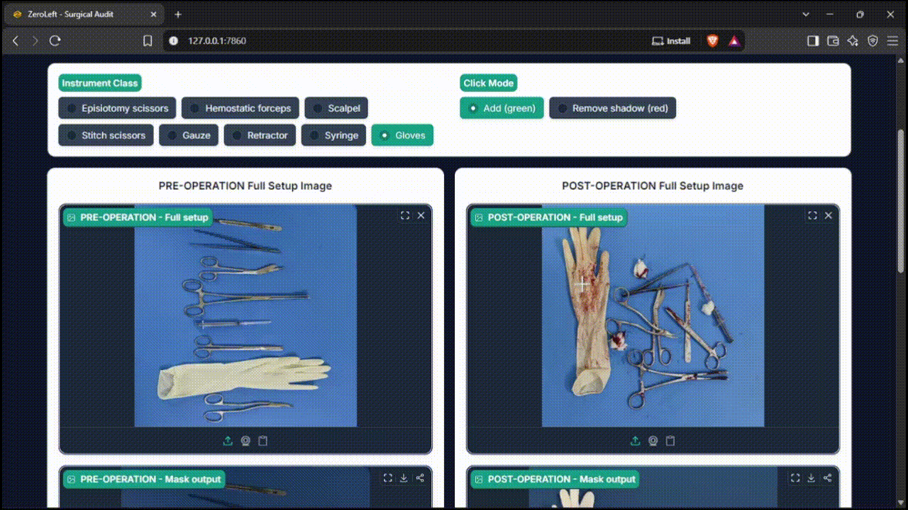
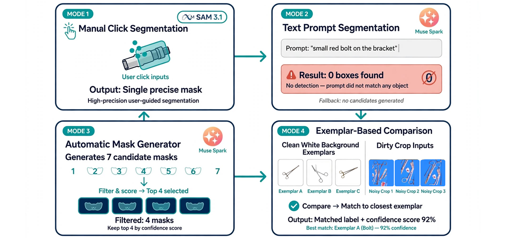
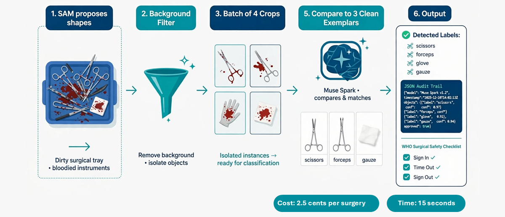

# ZeroLeft: A Surgical Tool Traceability Based on Meta SAM 3

[](https://cerebralvalley.ai/events/~/e/meta-ai-developer-hackathon?modalCloseUrl=%2Fevents%2Fregistered)
[](https://opensource.org/licenses/MIT)
[](https://www.python.org/)
[]((https://img.shields.io/badge/Status-Experimental-orange.svg))


## Abstract
Surgical instrument traceability remains a critical challenge in modern healthcare, where counting, identification, and verification processes still rely heavily on manual workflows. While recent advances in computer vision have demonstrated promising results, real-world surgical environments present persistent difficulties due to specular reflections, occlusions, overlapping instruments, and visually similar tool geometries.

**ZeroLeft** is an experimental framework developed to automatically audit PRE- and POST-surgical instrument trays, exploring the capabilities and limitations of foundation vision models (Meta SAM 3.1 and Muse Spark) for fine-grained surgical instrument segmentation and classification. Built for the **Meta Global AI Developer Hackathon 2026**, this project investigates whether foundation models can serve as a flexible alternative to task-specific approaches, while providing a reproducible testbed for future research in intelligent surgical instrument management.

> **Core Finding**: SAM's strength in zero-shot generalization is precisely its deficiency in surgical audit contexts, where 1 cm of curvature distinguishes a Babcock from a DeBakey forceps. This repository documents five concrete breaking points where foundation models fail under real surgical conditions.

## Key Capabilities
- **Zero-Shot Generalization**: Leverages Meta SAM 3.1 to isolate fine-grained surgical tools (e.g., forceps, scalpels, gauzes, gloves) and anatomical regions without custom fine-tuning.
- **Interactive Spatial Prompting**: Enables instrument segmentation through point, box, or text prompts, facilitating rapid experimentation in complex scenarios.
- **Automated Spatial Reporting**: Integrates Muse Spark to analyze mask dimensions, spatial orientation, and contextual information derived from segmented instruments.
- **Audit Trail Export**: Generates structured JSON logs and WHO Safe Surgery checklist reports for downstream verification.
    
## Solution Architecture
ZeroLeft was built as an experimental testbed to stress-test SAM's foundation models on real surgical trays. The system is split into two layers: the 4 interaction modes (how you use it) and the final agentic pipeline (how it works internally).

### Layer 1: Interaction Modes



We implemented 4 modes to isolate and measure each capability of SAM:

**Input:** Two Real Operation Room Tray (640x640 px) [PRE and POST operation].

*   **Mode 1: Manual Point Prompting (SAM ViT-B local, 1–2s/click):** Baseline. Local vit_b on CPU, 15s. User clicks, SAM segments, mask is accumulated by class color. This proved segmentation quality but requires human-in-the-loop.

*   **Mode 2: Text-Prompt Segmentation (SAM 3.1 API, 2–3s):** We send text like "glove, gauze, syringe". SAM 3.1 API returns masks. Logged failure with specific objects: `Babcock, DeBakey, Metzenbaum, scalpel`. It only understands generic concepts.

*   **Mode 3: Automated Counting + Clinical Report:** SAM 3.1 segments the whole tray, we do counter diff PRE vs POST -> MISSING / EXTRA / OK, then Muse Spark 1.3 generates a WHO surgical safety checklist and clinical report.

*   **Mode 4: Final Agentic System (Proposer + Exemplar Classifier):** Our Push the Frontier contribution. This is the pipeline detailed below.

### Layer 2: Final Agentic Pipeline (Mode 4)



This is where we stopped asking SAM 3.1 for names and used it only as a shape proposer:

1.  **Proposal (SAM Auto Mask Generator):** SAM Auto Mask Generator proposes 7 masks with `points_per_side=16, crop_n_layers=0`. No semantics.
2.  **Filtering:** We filter background and duplicate masks by area and stability. This removes wrong masks and mask collapse (e.g., glove and gauze sharing mask).
3.  **Cropping:** Each valid bbox is cropped with +10px padding from the original 640x640 image.
4.  **Classification (Muse Spark 1.3 Batch):** We send a batched request with dirty crops + clean 512x512 white-background exemplars as few-shot truth. Spark returns JSON: `{"label": "Mayo Scissors", "confidence": 0.92, "bbox": [...]}`. Batching reduces latency from 288s (sequential) to ~25s.
5.  **Audit & Export:** PRE vs POST comparison using exemplars as truth. Output: `inventory.json`, `evaluation_breakdown.json`, `WHO checklist`, and Muse Spark clinical narrative. Full audit trail is reproducible.

**Cost:** $0.025 and ~15s per surgery (SAM 3.1 proposal + Spark batch). Spent <$0.50 of $150 Meta credits during hackathon (200+ calls).

## Documented Breaking Points
These are not simulated failures. They are real logs from Meta's SAM 3.1 API during the hackathon. We kept them unedited.

```text
[INFO] SAM 3.1 API call for concept: 'Babcock' → 0 boxes, 0 masks
[INFO] SAM 3.1 API call for concept: 'DeBakey' → 0 boxes, 0 masks
[INFO] SAM 3.1 API call for concept: 'Metzenbaum' → 0 boxes, 0 masks
[INFO] SAM 3.1 API call for concept: 'gauze' → 1 masks
[INFO] SAM 3.1 API call for concept: 'glove' → 1 masks
```

SAM 3.1 doesn't return low confidence. It returns nothing when the term is too surgical. We found 5 systematic failures:

| # | Breaking Point | Description |
|---|----------------|-------------|
| 1 | Gauze vs Glove | Both are white and crumpled. SAM merges them into the same mask (same xy: 382,150). In a real count, you would report a glove missing when it was actually gauze. |
| 2 | Blue tray becomes an instrument | The tray occupies 55% of the image. Our area filter is <60% to avoid removing large tools. The trade-off is impossible without semantics: if we filter more, we lose real instruments. |
| 3 | Syringe classified as DeBakey | Muse Spark is forced to pick from our exemplar list. If you only give it forceps as options, a syringe becomes "the closest forceps". This is closed-set bias - it never says "I don't know". |
| 4 | More tools = slower & worse | Auto Mask Generator time scales with clutter. 1 instrument: 4s. 7 instruments: 60s. And some tools are simply never proposed. |
| 5 | All scissors are just "scissors" | SAM 3.1 knows "scissors". It doesn't know "Metzenbaum 14cm curved vs Mayo 17cm straight". With our clean exemplars, Muse improves from 33% to 71% accuracy, but still labels it generic. For surgical audit, 1cm of curve matters.|

> Takeaway: SAM's biggest strength - zero-shot generalization - becomes its weakness in surgery, where the difference between two tools is 1cm of curve.

## Dataset & Testing
ZeroLeft was evaluated using open-access surgical images from:
- [Surgical Tools](https://www.kaggle.com/datasets/jocelyndumlao/surgical-tools/data)
- [HOSPI-Tools Dataset](https://zenodo.org/records/6796559?preview_file=Hospi_Tools_small_Mask_RCNN.zip).
 
The framework processes open-surgery frames, applying zero-shot boundary isolation under complex conditions including specular reflections, blood, and motion blur. All experiments are reproducible using the provided scripts and configuration files.

## Metrics
| Mode | Time | Detected | Precision | Babcock detected? | Break |
|------|------|----------|-----------|----------|-------|
| Local vit_b auto (16 pts) | 225s | 5 | 80% | 0 | Blood, overlaped tools |
| SAM 3.1 API text ```Babcock,DeBakey,Metzenbaum``` | 20s | 2 | 33% | 0 boxes | SAM does not recognize Babcock |
| SAM 3.1 API ```forceps,scissors,gauze,glove``` + exemplar batch | 25s | 6 | 71% | 1 (as forceps) | Improved, but scissors remain generic |

## Cost Analysis
With REAL API:

| Component | Cost per audit |
|-----------|----------------|
| SAM 3.1 ($2.50 / 1000 images) | $0.005 (2 images PRE/POST) |
| Muse Spark 1.3 (~$0.01 / 1K tokens; 4 exemplars + 7 crops ≈ 2000 tokens) | $0.02 |
| **Total per surgery audit** | **$0.025** |
| **$150 credits** | **6,000 surgeries** |
| Local vit_b alternative | $0, but 220s runtime |

## Getting Started
We designed this repo to be reproducible even without Meta API keys or new surgical images. Just follow these instructions to replicate our results in <15 minutes.

### 0. Requirements
- **Python version used for this project: Python 3.11.9** (tested on Windows 11 Pro 26H2 + VSCode). Other Python versions were not tested.
- 8GB RAM minimum. No GPU required, runs on CPU. For our tests we used a PC with the following specifications:
  - AMD Ryzen 7 5700G CPU
  - 32.0 GB RAM
- Git installed.

### 1. Clone and Environment Setup
```bash
git clone https://github.com/MurilloLog/ZeroLeft.git
cd ZeroLeft

# Create virtual environment (recommended)
python -m venv venv

# Activate virtual environment (for windows):
venv\Scripts\activate

# (Or if you are using Linux/Mac):
source venv/bin/activate

pip install -r requirements.txt
# torch, segment-anything, openai, meta-sam-parser, gradio, python-dotenv

# Download the SAM free-weights
curl -O https://dl.fbaipublicfiles.com/segment_anything/sam_vit_b_01ec64.pth
# If you don't have curl, download manually and place in project root
```

### 3. Test Images and Exemplars Already Included
You don't need to provide new images to validate.

- ```data/sample_images/``` folder has 6 real tray images (640x640 px) from OR we used for the demo.
- ```exemplars_clean/``` folder has 10 clean exemplars on white background, 512x512, centered (Babcock, DeBakey, Metzenbaum, Mayo Scissors, etc.). Already included, you can run Mode 4 directly.

If you want to test with your own images, just replace those folders. Keep 640x640 px for best results.

### 3. Environment Variables (```.env```) - OPTIONAL
**Important: You do NOT need an API key to run and validate the system.**

The app has a built-in mock mode that simulates SAM 3.1 + Muse Spark responses without any external call. This is enabled by default if you uncheck the box ```Run in real mode```.

If you want to use the real Meta APIs (recommended for full results):

Create a ```.env``` file in root with the following variables:

```ini
META_API_KEY=your_meta_api_key_from_dev.meta.ai
META_API_BASE=https://api.meta.ai/v1
SAM_TEXT_MODEL=sam-3.1
LLAMA_MODEL=muse-spark-1.3-contributor
```

Each API call has a cost involved. We spent <$0.50 for 200+ calls. If you don't have a key, just skip this file.

### 4. Launch the Application
```bash
python app.py
# Open http://127.0.0.1:7860 in your browser
```

### 5. How to Run Mode 4 (Final Agentic Pipeline)
1. Upload PRE image: Use ```data/sample_images/pre-op_test1.jpg``` (or your own test image).
2. Upload POST image: Use ```data/sample_images/post-op_test1.jpg```.
3. In text prompt box, write generic terms that SAM 3.1 understands: forceps, scissors, gauze, gloves - Do NOT use fine-grained names like Babcock, we documented that returns 0 boxes.
4. **REAL API checkbox**:
- **UNCHECKED (default, no key needed)**: Runs in MOCK mode. Simulates SAM proposals and Muse Spark classification. Perfect to validate that the app launches, the pipeline works, and JSON exports are generated. Use this if you are a judge without API key.
- **CHECKED (requires .env)**: Calls real Meta SAM 3.1 and Muse Spark 1.3 APIs. Batched, ∼15s, $0.025 per run.
5. Click **Run Comparison**.

### 6. Generated Outputs (Auto-created)
Even in mock mode, these files are created to prove replication:

- ```exports/inventory_PRE_POST_*.json``` - structured audit trail with bboxes
- ```exports/evaluacion_quiebre_*.json``` - our 5 documented breaking points
- ```exports/who_clinical_*.txt``` - WHO Safe Surgery checklist + clinical report

All exports are timestamped.

### Common Issues for Beginners
- **sam_vit_b_01ec64.pth** not found: Make sure the .pth is in the root folder, not in a subfolder.
- **Port 7860 already in use**: Run python app.py --server-port 7861
- **No module named 'segment_anything'**: Did you activate venv? Run ```pip install -r requirements.txt``` again.
- **API returns 0 masks**: This is expected for fine-grained terms. Use generic terms: forceps instead of DeBakey. This is part of our documented breaking points, not a bug.

## Repository Structure
```
ZeroLeft/
├── app.py                          # Gradio UI Mode 1-4 (main entry)
├── sam_client.py                   # SAM local + SAM 3.1 API + Mock backend
├── requirements.txt                # Pinned versions for Python 3.11.9
├── .env                            # Template for API keys (optional)
├── exemplars_clean/                # 10 clean exemplars INCLUDED (512x512 white bg)
├── data/
│   └── sample_images/              # 6 test images INCLUDED
├── exports/                        # Auto-generated audit logs
├── sam_vit_b_01ec64.pth            # SAM vit_b checkpoint (367MB, download)
└── README.md
```

## Roadmap & Future Work
[X] Zero-shot single-frame point-prompt segmentation via SAM 3.1.

[X] Multi-prompt bounding box isolation.

[ ] Real-time video stream processing and temporal mask tracking.

[ ] Integration with WebXR/Augmented Reality viewports for heads-up surgical displays.

[ ] Expanded exemplar library covering full standard surgical tray inventory.

[ ] Quantitative benchmarking against task-specific detection baselines (e.g., Mask R-CNN on HOSPI-Tools).

## Limitations and Ethical Considerations
ZeroLeft is an **experimental research prototype** and is **not intended for clinical deployment**. Key limitations include:

- **Closed-set bias** in foundation models leads to systematic misclassification of visually similar instruments.

- **No regulatory validation** (e.g., FDA, CE) has been performed.

- **Patient data privacy**: All evaluation images are open-access; real OR deployment would require HIPAA/GDPR-compliant data handling.

- **False negatives** in instrument counting could have patient-safety implications; human verification remains mandatory.

## Citation
If you reference this work in academic or professional contexts, please cite:
```bibtex
@misc{gustavo-murillo2026,
  author = {Murillo Gutierrez, Gustavo Adolfo},
  title = {ZeroLeft: A Surgical Tool Traceability Based on Meta SAM 3},
  year = {2026},
  howpublished = {Meta Global AI Developer Hackathon 2026},
  note = {Experimental prototype; not for clinical use}
}
```
## License
Distributed under the MIT License. See [LICENSE](./LICENSE) for details.

## Contact & Team
Developed for the **Meta Global AI Developer Hackathon 2026** (Indie Developer Track. Solo Mode).

**Gustavo Adolfo Murillo** | [LinkedIn](https://www.linkedin.com/in/murillolog/)

## Demo Video
[](https://youtu.be/ze_SFyxsAlk)

**Full demo:** https://youtu.be/ze_SFyxsAlk

## Acknowledgments
- Meta AI for SAM 3.1 and Muse Spark API access.
- Kaggle and Zenodo for open-access surgical datasets.
- The open-source community behind segment-anything, Gradio, and PyTorch.